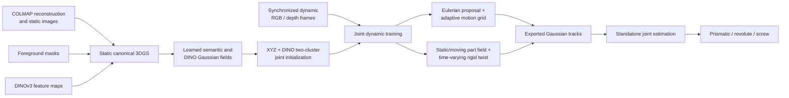

# RigEuler3DGS

RigEuler3DGS is a research implementation for reconstructing a fixed-camera
dynamic scene with 3D Gaussian Splatting (3DGS), separating the foreground into
one static part and exactly one moving rigid part, and estimating the moving
part's kinematic joint.

The repository extends the original GraphDeco 3DGS training stack with:

- a static canonical 3DGS reconstruction;
- learned per-Gaussian foreground semantics and DINOv3 descriptors;
- an Eulerian velocity proposal conditioned by an adaptive spatial grid;
- a trainable two-part static/moving assignment field;
- an explicit time-varying rigid twist for the moving part; and
- a standalone final estimator that selects a prismatic, revolute, or screw
  joint from the exported Gaussian trajectories.

This is a single-moving-part research pipeline, not a general multi-body
articulation system.

## Aim

The central problem is to recover both appearance and motion from synchronized
multi-camera observations while imposing only the rigid structure needed for
joint interpretation.

Given calibrated, fixed cameras observing an articulated object over time, the
pipeline aims to learn:

1. a canonical set of 3D Gaussians representing the scene at time zero;
2. which foreground Gaussians belong to the static body and moving rigid part;
3. a continuous Eulerian velocity field that can explain image-space motion;
4. a bounded rigid velocity model for the moving part; and
5. a final joint type, axis, anchor, direction, and pitch where applicable.

The proposal velocity field supplies flexible motion early in training. A
continuous handover then transfers confident moving Gaussians to the explicit
rigid model. This avoids a hard discovery/rigid phase boundary while retaining
an interpretable final motion representation.

## Pipeline at a glance



### Stage 1: static canonical reconstruction

The default first 30,000 iterations preserve the standard 3DGS optimization
path. Gaussian position, covariance, opacity, color, and exposure are optimized
from the COLMAP scene. Densification follows the GraphDeco schedule and ends at
iteration 15,000 by default.

When masks and DINO targets are available, the same stage also learns:

- one foreground semantic logit per Gaussian; and
- one low-dimensional DINO descriptor per Gaussian, 32 channels by default.

Both fields are rendered through the Gaussian rasterizer and supervised in
image space. Local 3D smoothness regularizes the semantic and DINO fields.

### Stage 2: joint dynamic training

Dynamic training is enabled with `--dynamic_motion` and lasts 15,000 iterations
by default. The fixed COLMAP cameras are cloned over the frames found under
`rgb/`; each training sample therefore carries a camera, frame id, and normalized
time.

The canonical Gaussian geometry and appearance are frozen in the default joint
branch. The trainable dynamic state consists of:

- `EulerianVelocityField`: a spatial/time MLP that proposes unconstrained
  velocity;
- `AdaptiveMotionGrid`: learnable local features and an adaptive cell topology;
- `JointPartField`: per-Gaussian embeddings and two cosine prototypes for the
  static and moving slots;
- `TimeVaryingRigidTwist`: bounded angular and translational velocities; and
- exposure parameters.

The statically learned per-Gaussian DINO descriptors are frozen during this
stage. Dynamic DINO rendering loss therefore trains transport, rather than
allowing descriptors to drift to fit each frame.

#### Exact two-part initialization

The joint branch initializes the foreground partition from canonical position
and frozen DINO descriptors. For foreground Gaussians `i` and `j`, it builds the
full pairwise distance

```text
D(i,j) = w_xyz * ||x_i - x_j|| / s_xyz
       + w_dino * (1 - cosine(z_i, z_j)).
```

Two-cluster k-medoids is then run on that matrix. The larger cluster becomes
static slot `0`; the other becomes moving slot `1`. The matrix is computed on
CPU and stored as float16 by default because its memory cost is quadratic in
the number of foreground Gaussians. The assignments subsequently remain
trainable through the cosine part field.

#### Proposal and rigid velocity

The proposal model is conceptually

```text
v_proposal(x,t) = MLP([x / scene_scale, Fourier(t), grid_feature(x)]).
```

The explicit rigid expert predicts

```text
v_rigid(x,t) = omega(t) x (x - center) + u(t),
```

where `omega(t)` and `u(t)` are bounded outputs of a time MLP and `center` is a
fixed canonical foreground center.

Rendering uses confidence-gated transport. The moving probability `p` is
detached before transport so rendering gradients train the motion experts,
while the assignment losses train the part field. With static threshold
`tau_s = 0.20`, moving threshold `tau_m = 0.80`, and rigid handover `h`, the
implementation computes

```text
s = clamp((tau_s - p) / tau_s, 0, 1)          # static confidence
m = clamp((p - tau_m) / (1 - tau_m), 0, 1)    # moving confidence
q = clamp(1 - s - m, 0, 1)                    # proposal weight

v_moving    = (1 - h) * v_proposal + h * v_rigid
v_transport = q * v_proposal + m * v_moving.
```

Consequently, points below `0.20` have proposal motion attenuated continuously
to zero as `p` approaches zero; points from `0.20` through `0.80` use the full
proposal; and points above `0.80` transition continuously toward the moving
expert. The handover `h` itself ramps from zero to one over the first 3,000
dynamic iterations. Semantic-background Gaussians never enter the part or
rigid-joint fit, but retain unrestricted proposal transport for rendering.

Foreground velocity is clamped to a norm of `3.0` by default. Positions are
transported with four midpoint explicit-Euler steps. The current implementation
transports Gaussian centers only; rotations and covariances remain canonical.

#### Dynamic objectives

The joint branch combines RGB, optional depth, dynamic DINO, and cycle losses
with objectives for:

- fitting the explicit twist to detached moving proposal velocities;
- matching confident moving proposals to the detached rigid expert;
- suppressing proposal velocity on confident static points;
- assigning identity-versus-rigid labels from motion residuals;
- compact and pairwise-consistent part embeddings;
- separated static/moving prototypes;
- low assignment entropy with non-empty-part occupancy; and
- temporally smooth rigid twists.

All joint objectives are active together. The older discovery/motion branch can
still be selected with `--disable_joint_single_rigid_training`, but it is not the
default pipeline described here.

### Stage 3: final joint estimation

Training exports trajectories and the learned rigid twist to
`gaussian_tracks.pt`. Joint estimation is deliberately a separate command; it
is not invoked automatically by `train.py`.

The estimator strictly selects moving points from the semantic foreground and
the learned two-slot assignment, fits candidate kinematic models, and selects
among:

- **prismatic**: translation along a fixed direction;
- **revolute**: rotation around a fixed axis with negligible axial pitch; and
- **screw**: rotation plus translation along the same axis.

See [TRAIN_PIPELINE_AND_JOINT_ESTIMATION_REPORT.md](TRAIN_PIPELINE_AND_JOINT_ESTIMATION_REPORT.md)
for the complete call graph, tensor flow, equations, loss routing, artifact
schema, estimator derivation, and implementation risks.

## Repository structure

```text
RigEuler3DGS/
├── train.py                         Main static + dynamic training entry point
├── arguments/
│   └── __init__.py                 GraphDeco and RigEuler3DGS CLI definitions
├── gaussian_renderer/
│   ├── __init__.py                 RGB/depth/semantic/DINO rasterization
│   └── network_gui.py              Optional GraphDeco network viewer support
├── scene/
│   ├── gaussian_model.py           Canonical Gaussians and dynamic orchestration
│   ├── motion_field.py             Eulerian velocity MLP and integration
│   ├── adaptive_motion_grid.py     Adaptive grid features and topology updates
│   ├── joint_part_field.py         Two-slot cosine assignment field
│   ├── rigid_twist_field.py        Time-varying bounded rigid twist
│   ├── dynamic_sequence_dataset.py Dynamic frame/camera sequence construction
│   ├── dinov3_utils.py             DINO target discovery and extraction helpers
│   ├── cameras.py                  Static and dynamic camera representation
│   ├── dataset_readers.py          COLMAP/Blender scene loading
│   ├── colmap_loader.py            COLMAP binary/text parsing
│   ├── sapien_dynamic_reader.py    SAPIEN-oriented dynamic data helpers
│   └── __init__.py                 Scene lifecycle and checkpoint/PLY loading
├── utils/
│   ├── dynamic_loss_utils.py       Motion, assignment, rigidity, and cycle losses
│   ├── final_joint_estimation.py   Prismatic/revolute/screw model selection
│   ├── render_dynamic_motion.py    Post-training dynamic rendering
│   ├── visualize_*.py              Track, velocity, twist, and grid HTML exports
│   └── *.py                        GraphDeco math, camera, image, and loss helpers
├── tools/
│   ├── estimate_final_joint.py     Supported standalone final estimator CLI
│   ├── validate_final_joint_estimation.py
│   │                                  Synthetic estimator validation
│   ├── analyze_*.py / extract_*.py   Run diagnostics and data preparation
│   ├── visualize_*.py                Standalone visualization commands
│   └── apply_*.py / repair_*.py /
│       verify_*.py                    Historical migration/debug scripts; inspect
│                                      assumptions before using on current source
├── render.py                        GraphDeCo-style render entry point
├── metrics.py                       Image metric evaluation
├── full_eval.py                     Dataset-scale train/render/evaluate helper
├── convert.py                       COLMAP conversion helper inherited upstream
├── lpipsPyTorch/                    Vendored LPIPS evaluation wrapper
├── environment.yml                 Base Conda environment specification
├── install_after_conda_create.sh   CUDA/PyTorch/extension installation script
├── requirements_rigeuler3dgs_py311_cu128.txt
│                                      Machine snapshot, not the portable install
├── TRAIN_PIPELINE_AND_JOINT_ESTIMATION_REPORT.md
│                                      Detailed implementation report
├── README_DYNAMIC_EULERIAN_3DGS.md Historical Eulerian design/reference notes
├── README_UNIFIED_SEMANTIC_DINO_FEATURE_PATCH.md
│                                      Historical semantic/DINO patch notes
├── RIGEULER3DGS_CONTEXT.md          Development context and prior decisions
├── INSTALLATION_README.md           Additional environment notes
└── LICENSE.md                       Upstream licensing information
```

The CUDA dependency sources under `submodules/` are intentionally not tracked
in this repository. They must be supplied locally and are excluded by
`.gitignore` while the customized rasterizer is under development.

## Data layout

For dynamic training, pass the scene root with `--root_scene`. The code then
sets the ordinary 3DGS source path to `ROOT/colmap` automatically.

```text
ROOT/
├── colmap/
│   ├── images/                      Static/reference images used by COLMAP
│   └── sparse/0/
│       ├── cameras.bin              .txt equivalents are also accepted
│       ├── images.bin
│       └── points3D.bin
├── rgb/
│   ├── cam_000/frame_000000.png
│   ├── cam_000/frame_000001.png
│   └── cam_001/...
├── depth_npy/                       Optional; default depth format
│   └── cam_000/frame_000000.npy
├── depth_png/                       Optional alternative to depth_npy/
│   └── cam_000/frame_000000.png
├── mask/                            Strongly recommended for joint training
│   └── cam_000/frame_000000.png
└── dinov3/                          Precomputed or generated dense targets
    └── cam_000/frame_000000.pt
```

Camera directory names and frame ids must align across the enabled modalities.
The dynamic loader reuses the fixed COLMAP intrinsics and extrinsics for every
corresponding dynamic frame. Dynamic images are stored on CPU by default and
only the sampled frame is moved to CUDA.

Depth supervision is enabled by default; use `--no_depth` if the scene has no
depth maps. DINO use and the per-Gaussian DINO field are also enabled by
default. When dense targets are missing, the trainer attempts DINO extraction
at startup; `--extract_dinov3` also expresses that request explicitly. A
compatible local Hugging Face snapshot or torchhub model/weights must be
available. Online DINO model download is disabled unless explicitly allowed.

`--filter_sem` is **off by default**. Without it, every Gaussian is eligible for
the joint foreground initialization. For articulated object isolation, provide
foreground masks during static training and explicitly enable `--filter_sem`.

## Installation

### Required local CUDA sources

Before running the installer, populate at least:

```text
submodules/diff-gaussian-rasterization/
submodules/simple-knn/
submodules/dinov3/                   needed for the local torchhub DINO path
```

This project requires a customized `diff-gaussian-rasterization` implementation
whose `GaussianRasterizer` exposes `render_features(...)` for arbitrary-channel
per-Gaussian features. A vanilla GraphDeco rasterizer does not provide that API
and is insufficient for the semantic and DINO fields.

The dependency trees are intentionally local and unpinned in Git for now. Keep
your modified rasterizer under `submodules/`; it will remain untracked.

### Conda and CUDA setup

The supplied script targets Python 3.10, PyTorch 2.9.0, CUDA 12.8, and compute
capability 8.9 (RTX 4070/Ada):

```bash
conda env create -f environment.yml
conda activate rigeuler3dgs
bash install_after_conda_create.sh "$PWD"
```

Change `CUDA_HOME`, the PyTorch CUDA wheel, and `TORCH_CUDA_ARCH_LIST` in
`install_after_conda_create.sh` when using another CUDA toolkit or GPU
architecture. The requirements text file is an environment snapshot containing
machine-specific packages and paths; use `environment.yml` as the portable
starting point.

## Training

### Full static-to-dynamic run

```bash
python train.py \
  --root_scene /path/to/scene \
  -m output/scene_joint \
  --dynamic_motion \
  --filter_sem \
  --semantic_dynamic_threshold 0.5 \
  --no_wandb
```

Important defaults for this command are:

| Setting | Default | Meaning |
|---|---:|---|
| `--static_train_iters` | 30,000 | Canonical static stage length |
| `--euler_field_train_iters` | 15,000 | Joint dynamic stage length |
| `--joint_single_rigid_training` | enabled | Optimize the two-slot field and one rigid twist jointly |
| `--filter_sem` | disabled | Must be supplied explicitly to isolate semantic foreground |
| `--use_depth` | enabled | Select `depth_npy/` unless changed or disabled |
| `--use_dinov3` | enabled | Use dense DINO targets and Gaussian DINO field |
| `--enable_adaptive_grid` | enabled | Update motion-grid topology during dynamic training |
| `--grid_from_iter` | 500 | First dynamic iteration eligible for a grid update |
| `--grid_update_interval` | 250 | Grid update interval in global iterations |
| `--joint_rigid_handover_iters` | 3,000 | Proposal-to-rigid trust ramp |
| `--wandb` | enabled | Use `--no_wandb` for a local-only run |

Run `python train.py --help` for the full option set, including sequence
subsampling, DINO extraction, rendering, diagnostics, and individual loss
weights.

### Start dynamic training from a static reconstruction

Use `--start_ply` for a GraphDeco point cloud. It is distinct from
`--start_checkpoint`, which expects a `chkpnt*.pth` training checkpoint.

```bash
python train.py \
  --root_scene /path/to/scene \
  -m output/scene_joint \
  --dynamic_motion \
  --filter_sem \
  --start_ply /path/to/static_run/point_cloud/iteration_30000/point_cloud.ply \
  --start_ply_iteration 30000 \
  --no_wandb
```

Use a static output produced by this repository so its companion semantic and
DINO fields are available. Unless `--no_auto_static_resume` or
`--force_static_retrain` is supplied, the trainer can also reuse the expected
static PLY already present in the selected model directory.

## Outputs

The model directory contains ordinary GraphDeco configuration, point-cloud,
checkpoint, and validation artifacts plus dynamic outputs such as:

```text
output/scene_joint/
├── gaussian_tracks.pt                 Canonical positions, trajectories,
│                                      assignments, velocities, and rigid twist
├── dynamic_summary.json               Compact track/export metadata
├── gaussian_tracks_visualization.html Interactive trajectory visualization
├── velocity_field_visualization.html  Interactive velocity visualization
├── joint_initialization/              Pairwise initialization data and summaries
└── debug_phase_snapshots/
    ├── joint_early/
    ├── joint_mid/
    └── joint_final/                    PT/JSON/CSV and optional HTML diagnostics
```

Phase snapshots include assignment changes, residuals, per-point and per-cell
statistics, the twist trajectory, and adaptive-grid state. They are enabled by
default and can consume substantial disk space. Use
`--disable_phase_debug_snapshots` when they are not required.

Post-training RGB/depth rendering is opt-in through `--render_after_training`;
track and velocity HTML generation are enabled by default after dynamic
training. Generated datasets, outputs, model files, W&B data, and local
submodules are ignored by Git.

## Estimate the final joint

After dynamic training completes:

```bash
python tools/estimate_final_joint.py \
  --tracks output/scene_joint/gaussian_tracks.pt
```

The estimator writes beside the track file unless `--output_dir` is provided:

```text
final_joint_estimation.json       Selected model, parameters, diagnostics, scores
final_joint_estimation.html       3D moving points with the fitted joint geometry
final_joint_model_scores.html     Candidate-model score comparison
```

It refuses to fit when the export lacks a semantic foreground mask, assignment
probabilities, rigid twist, or enough moving foreground Gaussians. This is
intentional: the estimator does not silently fall back to background points.

## Validation

The final estimator has a synthetic validation suite covering all three joint
classes:

```bash
python tools/validate_final_joint_estimation.py
```

For a lightweight source check after changes:

```bash
python -m py_compile \
  train.py \
  scene/gaussian_model.py \
  scene/joint_part_field.py \
  scene/rigid_twist_field.py \
  utils/final_joint_estimation.py
```

Some `tools/apply_*`, `tools/repair_*`, and `tools/verify_*` scripts encode
earlier patch layouts or contracts. Treat the current source, this README, and
the detailed pipeline report as authoritative before running those scripts.

## Current constraints

- Exactly one foreground rigid part moves relative to one static part.
- Camera intrinsics and extrinsics are assumed fixed over the dynamic sequence.
- Semantic foreground filtering must be enabled explicitly with `--filter_sem`.
- Joint initialization forms a full foreground pairwise matrix and can become
  memory-intensive for large Gaussian sets.
- Only Gaussian centers are dynamically transported; rotations/covariances are
  not updated by the motion model.
- Final kinematic model selection is a separate post-training step.
- The customized rasterizer and other CUDA dependency sources are not yet
  versioned or pinned in this repository.
- This is research code with extensive diagnostics, not a production API.

## Documentation

- [Training pipeline and joint-estimation report](TRAIN_PIPELINE_AND_JOINT_ESTIMATION_REPORT.md):
  authoritative detailed walkthrough of the current implementation.
- [Dynamic Eulerian 3DGS notes](README_DYNAMIC_EULERIAN_3DGS.md): earlier design
  and implementation history.
- [Semantic/DINO feature notes](README_UNIFIED_SEMANTIC_DINO_FEATURE_PATCH.md):
  historical feature-field patch documentation.
- [Development context](RIGEULER3DGS_CONTEXT.md): repository evolution and
  decisions.
- [Installation notes](INSTALLATION_README.md): additional machine/environment
  context; prefer the installation procedure in this README when they differ.

## Upstream and license

RigEuler3DGS is derived from the GraphDeco 3D Gaussian Splatting codebase and
retains several upstream training, rendering, conversion, and evaluation
utilities. See [LICENSE.md](LICENSE.md) for the repository's licensing terms and
upstream attribution.
