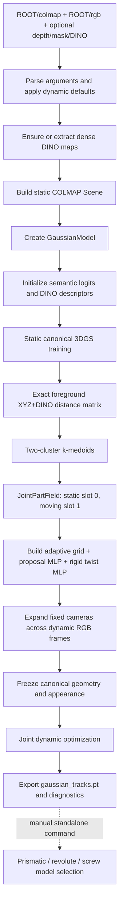

# `train.py` Pipeline and Joint-Estimation Report

> Detailed source-level analysis of the current working tree.
>
> Repository: `RigEuler3DGS`  
> Branch/commit inspected: `main` / `383db42`  
> Analysis date: 2026-07-16  
> Primary entry point: [`train.py`](train.py) (2,762 lines)  
> Status note: the working tree contains substantial uncommitted and untracked development work. This report describes the files as they exist in the working tree, not only commit `383db42`.

## Table of contents

1. [Executive summary](#1-executive-summary)
2. [Scope and source map](#2-scope-and-source-map)
3. [End-to-end pipeline](#3-end-to-end-pipeline)
4. [Command-line configuration and effective defaults](#4-command-line-configuration-and-effective-defaults)
5. [Input data and camera construction](#5-input-data-and-camera-construction)
6. [Startup, DINO extraction, scene construction, and resume](#6-startup-dino-extraction-scene-construction-and-resume)
7. [Static canonical 3DGS stage](#7-static-canonical-3dgs-stage)
8. [Static-to-dynamic transition](#8-static-to-dynamic-transition)
9. [Exact joint initialization](#9-exact-joint-initialization)
10. [Trainable static/moving part field](#10-trainable-staticmoving-part-field)
11. [Eulerian proposal and explicit rigid-twist models](#11-eulerian-proposal-and-explicit-rigid-twist-models)
12. [Joint transport rule and temporal integration](#12-joint-transport-rule-and-temporal-integration)
13. [Dynamic joint objective and gradient routing](#13-dynamic-joint-objective-and-gradient-routing)
14. [One training iteration, in exact execution order](#14-one-training-iteration-in-exact-execution-order)
15. [Adaptive motion grid](#15-adaptive-motion-grid)
16. [Optimizers, freezing, densification, and checkpoints](#16-optimizers-freezing-densification-and-checkpoints)
17. [Track export and diagnostics](#17-track-export-and-diagnostics)
18. [Final prismatic/revolute/screw estimation](#18-final-prismaticrevolutescrew-estimation)
19. [Observed output case study](#19-observed-output-case-study)
20. [Correctness risks and implementation gaps](#20-correctness-risks-and-implementation-gaps)
21. [Validation performed](#21-validation-performed)
22. [Recommended next actions](#22-recommended-next-actions)
23. [Glossary and symbol table](#23-glossary-and-symbol-table)

---

## 1. Executive summary

The current code is a two-stage extension of GraphDeco 3D Gaussian Splatting:

1. It first trains a canonical, static Gaussian scene using the normal RGB/SSIM/depth objective, Gaussian densification, a learned per-Gaussian semantic logit, and a learned per-Gaussian DINO descriptor.
2. It then freezes the canonical Gaussian geometry and appearance, expands fixed COLMAP cameras over a dynamic image sequence, and learns motion with an Eulerian proposal field.
3. In the default dynamic branch, the proposal is trained jointly with:
   - a two-slot per-Gaussian cosine part field (`static`, `moving`);
   - one explicit time-varying rigid twist, `omega(t), u(t)`;
   - a continuous handover from proposal transport to rigid transport;
   - an adaptive motion grid.
4. After training, it exports trajectories and diagnostic artifacts. A separate utility can classify the learned motion as prismatic, revolute, or screw and estimate its axis, anchor, and pitch.

The most important behavioral facts are:

- `--dynamic_motion` is **off** by default, but if dynamic motion is enabled then `--joint_single_rigid_training` is **on** by default.
- The default dynamic schedule is 30,000 static iterations followed by 15,000 joint iterations, for 45,000 global iterations.
- Joint mode does **not** use the legacy discovery/motion phase split. The proposal field, two-slot assignments, and explicit rigid twist are optimized together from the first dynamic iteration.
- The exact initialization is an `O(N_fg^2)` full pairwise XYZ+DINO distance matrix followed by two-cluster k-medoids. Its default storage is CPU float16.
- The largest initialized cluster is renamed static slot `0`; the smaller cluster becomes moving slot `1`. This is a convention, not an independently verified physical fact.
- `--filter_sem` is **off** by default. Consequently, the required foreground mask is all-true by default and exact joint initialization operates on the entire Gaussian scene. True semantic isolation requires `--filter_sem` or its alias.
- The trainable assignments affect rendering through a three-zone confidence rule: confident static points are stopped, uncertain points retain proposal motion, and confident moving points progressively hand over to the rigid expert.
- Assignment probabilities are detached inside the transport rule. Photometric/DINO rendering evidence therefore trains motion but does not directly train the part assignment through the motion mixture.
- Canonical Gaussian centers are advected, but Gaussian covariance orientation is not rotated with the learned rigid motion.
- Final joint model selection exists in [`utils/final_joint_estimation.py`](utils/final_joint_estimation.py), but the current [`train.py`](train.py) does **not** call it. It must be run manually with [`tools/estimate_final_joint.py`](tools/estimate_final_joint.py).

### High-level dataflow



---

## 2. Scope and source map

This report follows the active call graph, not the prose in older README or patch files. The key implementation files are:

| File | Responsibility |
|---|---|
| [`train.py`](train.py) | CLI entry, stage schedule, training loop, losses, adaptive-grid updates, exports, visualization hooks |
| [`arguments/__init__.py`](arguments/__init__.py) | Public dynamic arguments and effective internal defaults |
| [`scene/__init__.py`](scene/__init__.py) | Scene construction, dynamic camera expansion, timestamp normalization |
| [`scene/gaussian_model.py`](scene/gaussian_model.py) | Canonical Gaussian state, dynamic state, motion query/integration, joint initialization, optimizers, checkpoint state, track export |
| [`scene/joint_part_field.py`](scene/joint_part_field.py) | Exact XYZ+DINO matrix, k-medoids, two-slot cosine assignment field, clustering losses, occupancy enforcement |
| [`scene/motion_field.py`](scene/motion_field.py) | Eulerian proposal velocity MLP and explicit-Euler integration |
| [`scene/rigid_twist_field.py`](scene/rigid_twist_field.py) | Bounded time-varying `omega(t), u(t)` MLP |
| [`scene/adaptive_motion_grid.py`](scene/adaptive_motion_grid.py) | Persistent Gaussian-to-cell mapping, trainable cell features, score EMA, split/merge topology |
| [`scene/dynamic_sequence_dataset.py`](scene/dynamic_sequence_dataset.py) | Fixed-camera dynamic sequence expansion and optional depth/DINO path construction |
| [`utils/loss_utils.py`](utils/loss_utils.py) | Semantic and DINO image-domain auxiliary losses plus 3D smoothness |
| [`utils/dynamic_loss_utils.py`](utils/dynamic_loss_utils.py) | Timestamps, cycle loss, legacy dynamic losses, adaptive-grid scores, active joint objective |
| [`utils/final_joint_estimation.py`](utils/final_joint_estimation.py) | Post-training prismatic/revolute/screw fitting and model selection |
| [`tools/estimate_final_joint.py`](tools/estimate_final_joint.py) | Standalone CLI for final joint estimation |
| [`tools/validate_final_joint_estimation.py`](tools/validate_final_joint_estimation.py) | Synthetic validation for all three final joint types |

The most useful entry locations are:

- stage selection: [`train.py:285`](train.py#L285)
- static render loss: [`train.py:316`](train.py#L316)
- active dynamic losses: [`train.py:411`](train.py#L411)
- adaptive-grid update: [`train.py:912`](train.py#L912)
- track export: [`train.py:1949`](train.py#L1949)
- main training function: [`train.py:2103`](train.py#L2103)
- dynamic transition closure: [`train.py:2148`](train.py#L2148)
- foreground-mask construction: [`scene/gaussian_model.py:308`](scene/gaussian_model.py#L308)
- dynamic model initialization: [`scene/gaussian_model.py:607`](scene/gaussian_model.py#L607)
- joint part initialization: [`scene/gaussian_model.py:751`](scene/gaussian_model.py#L751)
- joint velocity mixture: [`scene/gaussian_model.py:838`](scene/gaussian_model.py#L838)
- rendering-time transport: [`scene/gaussian_model.py:929`](scene/gaussian_model.py#L929)
- track tensor construction: [`scene/gaussian_model.py:1022`](scene/gaussian_model.py#L1022)
- exact distance matrix: [`scene/joint_part_field.py:66`](scene/joint_part_field.py#L66)
- k-medoids: [`scene/joint_part_field.py:151`](scene/joint_part_field.py#L151)
- trainable part field: [`scene/joint_part_field.py:289`](scene/joint_part_field.py#L289)
- active joint loss: [`utils/dynamic_loss_utils.py:1831`](utils/dynamic_loss_utils.py#L1831)
- final joint estimator: [`utils/final_joint_estimation.py:263`](utils/final_joint_estimation.py#L263)

---

## 3. End-to-end pipeline

### 3.1 Runtime phases

With the default dynamic settings, the global iteration schedule is:

| Global iteration | Euler iteration | Stage returned by `dynamic_stage()` | Trainable subsystem |
|---:|---:|---|---|
| `1 ... 30,000` | `0` | `static` | canonical Gaussians, exposure, semantic logits, DINO descriptors |
| `30,001 ... 45,000` | `1 ... 15,000` | `joint` | exposure, proposal MLP, grid features, rigid twist, point embeddings, prototypes |

The stage condition is inclusive: `iteration <= static_train_iters` is static. The first dynamic iteration is therefore `static_train_iters + 1` ([`train.py:285-313`](train.py#L285)).

When joint mode is disabled, the same function can return `discovery`, `motion`, and optionally `finetune`. Those legacy stages and their large collection of optional losses remain in the code, but they are not part of the default joint pipeline.

### 3.2 Pipeline state transitions

The state evolves as follows:

```text
COLMAP point cloud/cameras
  -> canonical Gaussian parameters
  -> densified static Gaussian set
  -> learned semantic logits + learned DINO descriptors
  -> fixed Gaussian identity for dynamic training
  -> initial two-slot XYZ+DINO clustering
  -> trainable cosine assignments
  -> proposal + rigid velocity experts
  -> integrated per-frame Gaussian centers
  -> exported tracks
  -> standalone physical joint-type estimation
```

The dynamic stage deliberately does not densify or prune Gaussians. This is essential because the following tensors depend on stable Gaussian identity:

- semantic logit;
- DINO descriptor;
- part-field embedding;
- foreground index;
- initial and current cluster ID;
- motion-grid cell ID;
- exported trajectory index.

### 3.3 Primary optimized objective

At a dynamic joint iteration, the effective loss is conceptually:

\[
\mathcal{L} =
\mathcal{L}_{rgb}
+ \lambda_d \mathcal{L}_{depth}
+ \lambda_{DINO,dyn}\mathcal{L}_{DINO}
+ \sum_k \lambda_k \mathcal{L}_{joint,k}
+ \lambda_{cycle}\mathcal{L}_{cycle}.
\]

Semantic mask supervision is static-only. The DINO field is frozen dynamically, but DINO image loss still sends gradients through transported positions to the motion models.

---

## 4. Command-line configuration and effective defaults

Dynamic arguments are declared in [`add_dynamic_args()`](arguments/__init__.py#L115) and then transformed in [`apply_dynamic_defaults()`](arguments/__init__.py#L766). The latter is authoritative because it overrides or derives several internal values after parsing.

### 4.1 Main stage controls

| Argument | Default | Effective meaning |
|---|---:|---|
| `--dynamic_motion` | false | Without it, only static GraphDeco-style training runs. |
| `--static_train_iters` | 30,000 | Last global iteration of canonical static training. |
| `--euler_field_train_iters` | 15,000 | Number of dynamic iterations. |
| `--joint_single_rigid_training` | true | Default dynamic branch if `--dynamic_motion` is enabled. |
| `--disable_joint_single_rigid_training` | false | Selects the older discovery/motion branch when present. |
| `--root_scene` | empty | Preferred dynamic scene root; maps `source_path` to `ROOT/colmap`. |
| `--start_ply` | empty | Resume from a saved GraphDeco PLY, distinct from a checkpoint. |
| `--start_ply_iteration` | `-1` | `-1` means treat the PLY as `static_train_iters`. |

When dynamic motion is active, the entry point replaces `args.iterations` with:

\[
I_{total} = I_{static} + I_{Euler}.
\]

It also forces both the static boundary and final iteration into the save/checkpoint lists ([`train.py:2722-2729`](train.py#L2722)).

### 4.2 Static 3DGS defaults

From [`OptimizationParams`](arguments/__init__.py#L87):

| Setting | Default |
|---|---:|
| RGB/SSIM mixture `lambda_dssim` | `0.2` |
| densify from | `500` |
| densify until | `15,000` |
| densification interval | `100` |
| opacity reset interval | `3,000` |
| densification gradient threshold | `0.0002` |
| inverse-depth weight, initial | `1.0` |
| inverse-depth weight, final | `0.01` |
| position LR | `1.6e-4 -> 1.6e-6` |
| feature LR | `2.5e-3` |
| opacity LR | `2.5e-2` |
| scaling LR | `5e-3` |
| rotation LR | `1e-3` |

### 4.3 Auxiliary feature defaults

| Setting | Default | Notes |
|---|---:|---|
| semantic field enabled | true | One logit per Gaussian. |
| semantic loss weight | `0.05` | Outer weight applied by `train.py`. |
| semantic 3D smoothness | `0.02` | Inner weight inside semantic loss. |
| semantic LR | `1e-3` | Added to canonical Gaussian optimizer. |
| DINO field enabled | true | One learned descriptor per Gaussian. |
| DINO dimension | `32` | Clamped to available target channels. |
| static DINO loss weight | `0.02` | Trains descriptors with detached geometry. |
| dynamic DINO loss weight | `0.003` | Trains transport with frozen descriptors. |
| DINO 3D smoothness | `0.05` | Inner DINO-field regularizer. |
| DINO LR | `1e-3` | Part of canonical optimizer during static stage. |

### 4.4 Joint initialization defaults

| Setting | Default |
|---|---:|
| moving rigid parts | exactly `1` |
| total part slots | `2` (`static + moving`) |
| XYZ distance weight | `1.0` |
| DINO cosine-distance weight | `1.0` |
| XYZ scale | robust automatic median (`-1`) |
| distance block size | `512` rows |
| requested distance device | CPU |
| distance storage | float16 |
| k-medoids iterations | `12` |
| save full matrix | true |
| point embedding dimension | `8` |
| assignment temperature | `1.0` |
| embedding initialization noise | `0.02` |

Although the parser accepts `--joint_init_distance_device cuda`, the implementation prints a warning and executes the exact matrix computation on CPU for GPU safety ([`scene/joint_part_field.py:66`](scene/joint_part_field.py#L66)).

### 4.5 Motion defaults

| Setting | Default |
|---|---:|
| proposal grid feature dimension | `32` |
| proposal hidden dimension | `64` |
| proposal layers | `3` linear layers |
| proposal time frequencies | `8` |
| proposal max velocity | `0` = unbounded output |
| integration steps | `4` |
| proposal MLP LR | `1e-3` |
| grid feature LR | `1e-2` |
| rigid-twist LR | `5e-4` |
| max angular output | `4.0` |
| max translational output | `2.0` |
| final total-velocity clamp | `3.0` |
| motion and assignment gradient clip | `1.0` |

### 4.6 Semantic foreground default: a critical nuance

`--filter_sem` defaults to false. [`build_dynamic_foreground_mask()`](scene/gaussian_model.py#L308) therefore returns an all-true mask unless semantic filtering is explicitly enabled.

The exact initializer refuses a missing mask ([`scene/joint_part_field.py:196`](scene/joint_part_field.py#L196)), but “mask required” does not imply “semantic isolation active.” Under defaults:

```text
foreground_mask exists
foreground_mask == all True
N_fg == N_scene
joint initialization and rigid fitting use the whole Gaussian scene
```

With `--filter_sem`, the foreground becomes:

\[
m_i = [\sigma(s_i) > \tau_{sem}],
\]

where `s_i` is the learned semantic logit and `tau_sem=0.5` by default. If fewer than 32 points pass, the top 32 semantic probabilities are selected.

---

## 5. Input data and camera construction

### 5.1 Expected layout

The preferred dynamic layout is documented directly in the argument function:

```text
ROOT/
  colmap/
    images/ or equivalent COLMAP image references
    sparse/0/{cameras,images,points3D}.{bin,txt}
  rgb/
    cam_000/frame_000000.png
    cam_000/frame_000001.png
    ...
  depth_npy/                         optional
    cam_000/frame_000000.npy
  depth_png/                         optional
    cam_000/frame_000000.png
  mask/                              optional but important for semantic isolation
    cam_000/frame_000000.png
  dinov3/                            precomputed or generated
    cam_000/frame_000000.pt
```

Passing `--root_scene ROOT` sets the standard GraphDeco `source_path` to `ROOT/colmap` before constructing the model namespace ([`train.py:2710-2720`](train.py#L2710)).

### 5.2 Static cameras first

The scene is intentionally built without dynamic sequence arguments during two-stage training:

```python
scene = Scene(dataset, gaussians, dynamic_args=None if dyn.dynamic_motion else dyn)
```

This keeps the first 30,000 iterations close to canonical GraphDeco training and avoids loading every dynamic frame before the one-time `N_fg^2` joint initialization ([`train.py:2121`](train.py#L2121)).

### 5.3 Dynamic expansion

At the dynamic transition, [`expand_fixed_colmap_cameras_to_dynamic_sequence()`](scene/dynamic_sequence_dataset.py#L258):

1. finds `cam_*` directories under `ROOT/rgb`;
2. maps each camera directory to a fixed COLMAP camera template;
3. clones that template for every selected frame;
4. attaches RGB, optional depth, DINO path, frame ID, and timestamp;
5. assigns frames to train/test according to `test_stride`.

The camera extrinsics and intrinsics remain fixed over time. The scene dynamics are represented by moving Gaussians, not moving cameras.

Dynamic images are stored on CPU by default (`--dynamic_camera_data_device cpu`). Only the sampled frame is transferred to CUDA in each iteration ([`train.py:2164-2178`](train.py#L2164)).

### 5.4 Timestamp normalization

[`normalize_camera_timestamps()`](utils/dynamic_loss_utils.py#L23) converts raw camera times to a normalized interval:

\[
t'_k = \frac{t_k-\min(t)}{\max(t)-\min(t)} \cdot time\_scale.
\]

It is called separately for the training and test camera lists in [`scene/__init__.py:151-152`](scene/__init__.py#L151). This creates a possible mismatch when `test_stride > 0`: each split can have a different minimum and maximum and therefore a different normalized time for the same raw sequence.

`get_camera_timestamp()` later multiplies a stored `camera.timestamp` by `time_scale` again ([`utils/dynamic_loss_utils.py:10`](utils/dynamic_loss_utils.py#L10)). For the default `time_scale=1`, this is harmless. For non-default values it applies the scale twice during training. Track export reads `camera.timestamp` directly and therefore does not apply the second multiplication. This is a train/export time inconsistency.

---

## 6. Startup, DINO extraction, scene construction, and resume

The startup order inside [`training()`](train.py#L2103) is important:

1. create logging outputs and W&B run;
2. instantiate `GaussianModel`;
3. check for or extract DINO maps;
4. construct a static `Scene`;
5. initialize per-Gaussian semantic and DINO fields;
6. synchronize their learning rates into optimization arguments;
7. build the canonical Gaussian optimizer;
8. resolve optional PLY/checkpoint resume;
9. enter the global iteration loop.

### 6.1 DINO extraction behavior

[`maybe_extract_dinov3_features()`](train.py#L1035) is activated by either `use_dinov3` or `use_dino_feature_field`. Because the DINO Gaussian field is enabled by default, missing dense maps trigger an extraction attempt by default after `apply_dynamic_defaults()`.

If extraction fails:

- with `--dinov3_required`, training aborts;
- otherwise, it warns and disables DINO handling.

Joint initialization later requires a nonempty learned DINO descriptor for every Gaussian and will abort if that condition is not met ([`scene/gaussian_model.py:634-649`](scene/gaussian_model.py#L634)). Thus, a non-required DINO extraction failure can still make the default joint path impossible.

### 6.2 Auxiliary-field initialization

[`init_gaussian_aux_feature_fields()`](train.py#L382) infers target DINO dimensionality from the first readable map and allocates:

- semantic logits `[N,1]`, initialized to zero;
- DINO descriptors `[N,K]`, random-normalized from small random values.

These parameters are created before `training_setup()`, so they become ordinary groups in the canonical Gaussian optimizer and follow static densification and pruning ([`scene/gaussian_model.py:353-375`](scene/gaussian_model.py#L353), [`scene/gaussian_model.py:444-460`](scene/gaussian_model.py#L444)).

### 6.3 PLY resume

The PLY path is resolved by [`_resolve_start_ply()`](train.py#L2057). The pipeline can:

- use an explicitly supplied `--start_ply`;
- automatically reuse the static PLY in the output directory;
- be forced to retrain using `--force_static_retrain`;
- disable auto-resume with `--no_auto_static_resume`.

After loading a PLY, auxiliary fields are initialized again and `training_setup()` is rebuilt. Correct joint behavior therefore depends on the PLY-side semantic/DINO companion tensors being present and loaded correctly; otherwise freshly random DINO descriptors can have a valid shape and pass the joint initializer's structural check.

### 6.4 Checkpoint resume

A `chkpnt*.pth` captures canonical Gaussian state plus dynamic model state. Dynamic model weights and grid topology are restored, but dynamic Adam optimizer moments are not part of `capture_dynamic_state()` ([`scene/gaussian_model.py:499-527`](scene/gaussian_model.py#L499)). Optimizers are reconstructed with fresh moments on load.

There is also a subtler canonical resume risk: `load_aux_state()` can replace auxiliary tensors with new `nn.Parameter` objects after the canonical optimizer has already been restored. If this happens mid-static resume, the optimizer can retain references to stale parameter objects. A full resume test should verify that semantic/DINO tensors in the optimizer are exactly the tensors returned by the model properties.

---

## 7. Static canonical 3DGS stage

### 7.1 RGB reconstruction

[`compute_base_render_loss()`](train.py#L316) defines:

\[
\mathcal{L}_{photo}
= (1-\lambda_{DSSIM})\,\|I-\hat I\|_1
+ \lambda_{DSSIM}\,(1-SSIM(I,\hat I)).
\]

With the default `lambda_dssim=0.2`:

\[
\mathcal{L}_{photo}=0.8\mathcal{L}_1+0.2(1-SSIM).
\]

The fused SSIM implementation is used if available; otherwise the PyTorch fallback is used.

### 7.2 Depth regularization

When a camera has reliable depth, the rendered inverse depth is compared against the camera inverse-depth map:

\[
\mathcal{L}_{depth}
= w_d(i)\,\operatorname{mean}(|(D^{-1}_{render}-D^{-1}_{target})M_d|).
\]

`w_d(i)` follows an exponential learning-rate-style schedule from `1.0` to `0.01` over the **total** configured iteration count, not only the static portion ([`train.py:2220`](train.py#L2220), [`train.py:2297-2313`](train.py#L2297)).

### 7.3 Semantic field

The semantic field is supervised only while `stage == "static"` ([`train.py:2315-2325`](train.py#L2315)). The rendered prediction is an alpha-composited scalar field. Geometry and opacity are detached, so the semantic loss updates semantic logits only.

The default BCE term is alpha weighted:

\[
\mathcal{L}_{sem,BCE}
= \frac{\sum_p A(p)\,BCE(\hat M(p),M(p))}
{\sum_p A(p)+\epsilon}.
\]

Optional Dice or BCE+Dice modes are available. A local color-aware 3D KNN smoothness term is added internally with default factor `0.02`. The total semantic loss is then multiplied by the outer `0.05` weight in `train.py` ([`utils/loss_utils.py:293`](utils/loss_utils.py#L293)).

### 7.4 DINO field

In static training, DINO descriptors are rendered with detached Gaussian geometry. The target is a dense normalized DINO map. This routes gradients into the per-Gaussian descriptor field without allowing DINO loss to move canonical Gaussians ([`utils/loss_utils.py:428`](utils/loss_utils.py#L428)).

The static outer weight is `0.02`. The descriptors are normalized for rendering and supervised primarily with cosine distance, optionally cosine+L1.

### 7.5 Densification and auxiliary tensor identity

Canonical Gaussian densification is active only when the stage is static and `iteration < densify_until_iter` ([`train.py:2397-2409`](train.py#L2397)). Cloning, splitting, and pruning propagate the semantic and DINO parameters alongside standard Gaussian tensors through optimizer-aware tensor replacement in [`scene/gaussian_model.py`](scene/gaussian_model.py).

No densification happens after iteration 15,000 under defaults, even though static training continues to 30,000. This allows all per-Gaussian auxiliary fields to settle on a fixed point set before the dynamic transition.

### 7.6 Static boundary save semantics

The static PLY is saved at global iteration 30,000 because that iteration is inserted into `save_iterations`. Saving occurs before the optimizer step block. The optimizer step then executes because `30,000 < 45,000`.

Therefore:

- the saved `iteration_30000` PLY reflects parameters before iteration 30,000's update;
- the in-memory model that enters iteration 30,001 includes that update.

The dynamic stage initialized in the same run is one optimizer update ahead of a later dynamic run resumed from the saved static PLY.

---

## 8. Static-to-dynamic transition

The transition is encapsulated by the nested [`initialize_dynamic_stage_once()`](train.py#L2148). Its order is:

1. ensure DINO maps again;
2. synchronize and empty the CUDA cache;
3. initialize dynamic motion if it has not been restored;
4. perform exact joint initialization;
5. allocate the adaptive grid, proposal MLP, rigid twist, and dynamic optimizers;
6. expand fixed COLMAP cameras over the dynamic image sequence;
7. rebuild the training camera stack;
8. export joint initialization artifacts;
9. freeze canonical geometry and appearance.

The exact `N_fg^2` initialization is deliberately performed before hundreds of dynamic camera objects are constructed, reducing peak memory pressure.

### 8.1 Frozen canonical state

[`freeze_canonical()`](scene/gaussian_model.py#L914) disables gradients for:

- `_xyz`;
- `_scaling`;
- `_rotation`;
- spherical-harmonic appearance features;
- opacity.

The default configuration also disables dynamic Gaussian finetuning. Exposure remains separately optimized throughout training.

### 8.2 Dynamic DINO behavior

The learned DINO descriptors are frozen in the joint dynamic stage. However, the rendered DINO loss uses live transported geometry. Its gradients update the proposal field/grid, and potentially any live transport path, rather than descriptor values.

This gives the motion field a correspondence-like feature signal while preserving the static DINO space used during exact initialization.

---

## 9. Exact joint initialization

Exact initialization spans [`GaussianModel.initialize_joint_part_field()`](scene/gaussian_model.py#L751) and [`initialize_joint_parts_from_static_dino()`](scene/joint_part_field.py#L196).

### 9.1 Foreground selection

Let `N` be all canonical Gaussians and `F` the selected foreground indices.

- Without `--filter_sem`: `F = {0,...,N-1}`.
- With `--filter_sem`: `F = {i | sigmoid(s_i) > threshold}`, with top-`min_points` fallback.

The joint part field, rigid loss, and final estimator are intended to operate only on `F`. In joint mode the proposal motion grid is still built for all Gaussians, so semantic-background points can retain unrestricted proposal motion without entering rigid fitting ([`scene/gaussian_model.py:619-629`](scene/gaussian_model.py#L619)).

### 9.2 Required DINO condition

The learned static DINO field must:

- be a tensor;
- be two-dimensional;
- have exactly `N` rows;
- have at least one feature channel.

The code freezes it before initialization. It checks shape and finiteness, but it does not prove that the descriptors received meaningful static supervision. Random normalized descriptors of the correct shape satisfy the structural check.

### 9.3 Robust spatial scale

If `joint_init_euclidean_scale <= 0`, [`_robust_xyz_scale()`](scene/joint_part_field.py#L48) estimates a scale from the median distance of sampled canonical foreground point pairs. The value is clamped away from zero.

### 9.4 Full combined distance matrix

For all foreground pairs `(i,j)`, the matrix is:

\[
D_{ij}
= \lambda_x \frac{\|x_i-x_j\|_2}{s_x}
+ \lambda_f\left(1-cos(z_i,z_j)\right).
\]

Defaults are `lambda_x=lambda_f=1`. `x_i` is the canonical center and `z_i` is the frozen learned DINO descriptor.

The matrix is allocated as `[N_fg,N_fg]` on CPU. Rows are computed in blocks of 512 with `torch.cdist` and a dense DINO matrix multiplication. The diagonal is forced to zero. Default storage is float16, but the k-medoids routine converts the entire matrix to float32 for assignment computations.

Approximate stored-matrix memory is:

\[
M_{fp16}\approx 2N_{fg}^2\text{ bytes}, \qquad
M_{fp32}\approx 4N_{fg}^2\text{ bytes}.
\]

Because `kmedoids_precomputed()` creates a float32 copy, peak CPU memory can include both representations. For `N_fg=50,000`, the two matrices alone would be roughly 5 GB + 10 GB, before temporary blocks and indexing.

### 9.5 K-medoids

[`kmedoids_precomputed()`](scene/joint_part_field.py#L151) uses:

1. the globally lowest mean-distance point as the first medoid;
2. farthest-first selection for the second medoid;
3. nearest-medoid label assignment;
4. within-cluster medoid recomputation by minimizing summed precomputed distance;
5. up to 12 iterations, with early convergence.

Exactly two clusters are enforced because the current physical model supports one moving part plus one static part.

### 9.6 Static-slot convention

After clustering, clusters are reordered by size:

- largest foreground cluster -> slot `0`, called static;
- remaining cluster -> slot `1`, called moving.

This is a heuristic assumption. It fails when the moving object occupies more foreground Gaussians than the static foreground support or when the foreground mask isolates only the moving link.

### 9.7 Initialization artifacts

[`save_joint_initialization()`](scene/joint_part_field.py#L490) writes:

```text
joint_initialization/
  joint_initial_clusters.pt
  combined_xyz_dino_distance_matrix.pt   # default enabled
  joint_initialization_summary.json
  joint_part_field_initial_summary.json
```

After persistence, the in-memory initialization result, including the large distance matrix, is released.

---

## 10. Trainable static/moving part field

[`JointPartField`](scene/joint_part_field.py#L289) stores trainable parameters only for foreground Gaussian IDs.

### 10.1 Parameterization

For each foreground Gaussian `i`:

- point embedding `a_i in R^8`;
- static prototype `c_0 in R^8`;
- moving prototype `c_1 in R^8`.

Assignments are cosine-softmax probabilities:

\[
p_{ik}
= \operatorname{softmax}_k\left(
\frac{\hat a_i^T\hat c_k}{\tau}
\right),
\qquad k\in\{0,1\}.
\]

The dynamic probability is:

\[
p_i = p_{i1}.
\]

Non-foreground points are represented as slot `0` in full bookkeeping tensors, but this representation must not be used to stop their proposal transport.

### 10.2 Initialization

The prototypes start as the first two standard basis vectors. Each point embedding starts from the basis vector associated with its k-medoids cluster plus Gaussian noise of standard scale `0.02`, then is normalized.

With no noise and temperature `1.0`, the same-slot cosine is `1`, the other-slot cosine is `0`, and the initial winning probability is:

\[
\frac{e^1}{e^1+e^0}\approx0.731.
\]

Therefore, even a hard k-medoids label begins inside the transport system's uncertain band rather than at probability `0` or `1`. This is deliberate: rendering evidence can develop before confident expert gating.

### 10.3 Field-only clustering losses

The field regularizers no longer use XYZ or DINO after initialization:

- **compactness:** assignments should have high cosine similarity to their prototypes;
- **pairwise:** same hard-slot samples should have similar embeddings and different-slot samples should remain below a cosine margin;
- **prototype separation:** off-diagonal prototype cosine should be below the margin;
- **assignment entropy:** minimizing entropy sharpens assignments;
- **soft occupancy:** each slot's mean probability should exceed the minimum fraction.

This separation is conceptually important: XYZ+DINO provides a one-time initialization, while dynamic evidence and field geometry determine later assignments.

### 10.4 Hard occupancy mutation

After every dynamic optimizer step, [`enforce_nonempty_parts()`](scene/joint_part_field.py#L442) requires each slot to have at least:

\[
n_{min}=\lceil0.02N_{fg}\rceil
\]

hard assignments. When a slot is deficient, point embeddings with the highest probability for that slot are directly moved toward its prototype using `.data`.

This is not a differentiable loss and happens outside Adam. Adam's first/second moments are not reset for modified embeddings, so optimizer state no longer exactly corresponds to the parameter trajectory.

---

## 11. Eulerian proposal and explicit rigid-twist models

### 11.1 Eulerian proposal field

[`EulerianVelocityField`](scene/motion_field.py#L83) models a world-fixed proposal:

\[
v_{prop}(x,t)=MLP([x/s_x,\phi(t),g_i]).
\]

Where:

- `x/s_x` contributes 3 values;
- `phi(t)` contains raw time plus 8 sine/cosine frequency pairs, contributing 17 values;
- `g_i` is the 32-dimensional feature of Gaussian `i`'s persistent motion-grid cell.

The default input dimension is therefore `3+17+32=52`. The network is:

```text
Linear(52,64) -> ReLU
Linear(64,64) -> ReLU
Linear(64,3)
```

It has 7,747 learned MLP parameters, excluding the variable-size grid feature tensor. The final layer is initialized to zero, so initial proposal velocity is exactly zero.

`motion_max_velocity=0` means the proposal output itself is unbounded. In joint mode, the mixed total foreground velocity is later norm-clamped to 3.0.

### 11.2 Persistent cell lookup

Grid features are selected by a stored `gaussian_cell_id`, not by spatially re-voxelizing the current advected point. Thus `g_i` remains attached to Gaussian identity as it moves. The field is Eulerian in its coordinate input `x`, but its local code is effectively material/identity attached.

### 11.3 Explicit rigid twist

[`TimeVaryingRigidTwist`](scene/rigid_twist_field.py#L44) maps only Fourier-embedded time to six bounded values:

\[
(\omega(t),u(t))=f_\psi(\phi(t)).
\]

The default MLP is:

```text
Linear(17,64) -> SiLU
Linear(64,64) -> SiLU
Linear(64,6)
```

It has 5,702 parameters. The outputs are bounded componentwise:

\[
\omega(t)=4\tanh(\omega_{raw}(t)),\qquad
u(t)=2\tanh(u_{raw}(t)).
\]

The final layer is zero initialized, so the rigid expert initially predicts zero velocity.

### 11.4 Rigid velocity equation

The center `c` is fixed once at the mean canonical position of the selected foreground:

\[
c=\frac{1}{N_{fg}}\sum_{i\in F}x_i^0.
\]

The rigid velocity is:

\[
v_{rigid}(x,t)=\omega(t)\times(x-c)+u(t).
\]

The model can represent a general instantaneous rigid twist. A time sequence of such twists is later approximated by fixed prismatic, revolute, or screw models during final estimation.

---

## 12. Joint transport rule and temporal integration

Transport is implemented by [`query_joint_velocity()`](scene/gaussian_model.py#L838) and [`integrate_joint_positions()`](scene/gaussian_model.py#L877).

### 12.1 Assignment detachment

The assignment probability is detached before entering the motion mixture:

```python
p = dynamic_prob.detach().clamp(0, 1)
```

Consequences:

- RGB/depth/DINO rendering losses update the proposal and rigid models through position transport;
- those losses do not directly update the part field through the mixture weight;
- the part field is trained by its label loss and clustering losses.

This prevents a trivial label shortcut but also weakens direct render-to-assignment supervision.

### 12.2 Confidence zones

Default thresholds are:

\[
\tau_s=0.2,\qquad \tau_m=0.8.
\]

The three coefficients are:

\[
c_s(p)=clip\left(\frac{\tau_s-p}{\tau_s},0,1\right),
\]

\[
c_m(p)=clip\left(\frac{p-\tau_m}{1-\tau_m},0,1\right),
\]

\[
c_u(p)=clip(1-c_s-c_m,0,1).
\]

Interpretation:

| Probability | Static confidence | Uncertain weight | Moving confidence |
|---:|---:|---:|---:|
| `0.0` | `1.0` | `0.0` | `0.0` |
| `0.2` | `0.0` | `1.0` | `0.0` |
| `0.5` | `0.0` | `1.0` | `0.0` |
| `0.8` | `0.0` | `1.0` | `0.0` |
| `1.0` | `0.0` | `0.0` | `1.0` |

The entire interval `[0.2,0.8]` receives full proposal motion. Only probabilities below `0.2` are progressively stopped, and only probabilities above `0.8` progressively enter the moving expert.

### 12.3 Rigid handover

The handover factor is:

\[
h(e)=clip\left(\frac{e-e_0}{H},0,1\right),
\]

with defaults `e_0=0` and `H=3000` dynamic iterations.

The moving expert is itself a mixture:

\[
v_{move}=(1-h)v_{prop}+h v_{rigid}.
\]

The final foreground velocity is:

\[
v_{total}=c_u v_{prop}+c_m v_{move}.
\]

The static coefficient does not appear explicitly because confident static mass contributes zero transport.

Important endpoint behavior:

- `p=0` -> zero velocity;
- `p in [0.2,0.8]` -> full proposal velocity;
- `p=1, h=0` -> proposal velocity;
- `p=1, h=1` -> rigid velocity.

The result is norm-clamped to 3.0 for the foreground.

### 12.4 Semantic background

During renderer-time [`set_time()`](scene/gaussian_model.py#L929), semantic-background points bypass joint assignments and rigid fitting. They are integrated only through the unrestricted proposal field. This is the intended separation:

```text
foreground -> joint confidence mixture and physical rigid fit
background -> free proposal transport only
```

With the default all-true mask, no semantic background exists and all points enter the joint branch.

### 12.5 Integration

For a target time `t`, the model uses four midpoint-time explicit Euler steps:

\[
\Delta t=t/S,\qquad
x_{k+1}=x_k+\Delta t\,v(x_k,(k+1/2)\Delta t),
\qquad S=4.
\]

This is computationally cheap and differentiable but first-order accurate. The final cached velocity and twist correspond to the last midpoint evaluation, not exactly to target time `t`. For a forward integration from zero with four steps, the final query time is `0.875t`.

### 12.6 Gaussian orientation is not transported

[`set_time()`](scene/gaussian_model.py#L929) updates `_current_xyz` but sets `_current_rotation` to the canonical rotation. A rigid part's Gaussian centers rotate around an axis, but their anisotropic covariance orientations do not rotate with the body.

This can cause:

- view-dependent reconstruction error;
- proposal-field compensation;
- biased rigid residuals;
- inconsistent physical motion for elongated Gaussians.

---

## 13. Dynamic joint objective and gradient routing

The joint branch in [`add_dynamic_losses()`](train.py#L411) calls [`joint_single_rigid_losses()`](utils/dynamic_loss_utils.py#L1831) at every dynamic iteration.

### 13.1 Pseudo-Huber vector penalty

Most velocity residuals use:

\[
\rho_\delta(e)
=\delta^2\left(\sqrt{1+\frac{\|e\|_2^2}{\delta^2}}-1\right),
\]

with `delta=0.05`. If delta is nonpositive, squared norm is used.

### 13.2 Loss table

| Loss | Default weight | Primary target | Detached side / gradient route |
|---|---:|---|---|
| `twist_fit` | `0.10` | rigid velocity matches proposal | proposal detached; trains rigid twist |
| `proposal_rigid` | `0.05` | proposal matches rigid velocity on `p>=0.8` | rigid detached; trains proposal/grid |
| `proposal_static` | `0.02` | proposal goes to zero on `p<=0.2` | assignment mask detached; trains proposal/grid |
| `label` | `0.05` | assignment matches identity-vs-rigid evidence | both velocity experts detached; trains part field/prototypes |
| `field_compact` | `0.02` | embeddings align with prototypes | part field/prototypes |
| `field_pairwise` | `0.01` | same slot close, different slots separated | part field |
| `prototype_separation` | `0.01` | prototypes below cosine margin | prototypes |
| `assignment_entropy` | `0.002` | low assignment entropy | part field/prototypes |
| `part_occupancy` | `0.02` | noncollapsed soft slot mass | part field/prototypes |
| `twist_smooth` | `0.01` | temporally smooth `omega,u` | rigid twist |
| `cycle` | `0.01` | integrate current positions back to canonical | motion transport models |

All legacy global twist, model-target, discovery sparsity/binarization, motion-aware coherence, and contrastive label losses are set to zero in `apply_dynamic_defaults()` when joint mode is active ([`arguments/__init__.py:1139`](arguments/__init__.py#L1139)).

### 13.3 Twist fitting

Hard moving-slot membership is taken from detached cosine assignments:

\[
m_i=[argmax_k\ p_{ik}>0].
\]

Proposal speed provides a quality weight, not membership. Let `s_80` be the 80th percentile proposal speed:

\[
r_i=clip(\|v_{prop,i}\|/s_{80},0,1),
\]

\[
w_i=m_i\,p_i\,(0.1+0.9r_i).
\]

Then:

\[
\mathcal{L}_{twist}
=\frac{\sum_i w_i\rho(v_{rigid,i}-stopgrad(v_{prop,i}))}
{\sum_i w_i}.
\]

The detached proposal is essential: at initialization both experts output zero, and later the proposal should teach the rigid expert rather than collapse toward a still-weak rigid model.

### 13.4 Proposal-to-rigid alignment

Only confident moving points, `p_i>=0.8`, receive:

\[
\mathcal{L}_{prop-rigid}
=mean\ \rho(v_{prop,i}-stopgrad(v_{rigid,i})).
\]

Uncertain points remain free to collect rendering evidence.

### 13.5 Proposal static suppression

Only confident static points, `p_i<=0.2`, receive:

\[
\mathcal{L}_{prop-static}=mean\ \rho(v_{prop,i}).
\]

This avoids suppressing slow but truly moving points near a hinge merely because they currently have middling assignment probability.

### 13.6 Assignment target

The label target compares two explanations of the detached proposal:

\[
e_{static,i}=\|v_{prop,i}\|,
\]

\[
e_{rigid,i}=\|v_{prop,i}-v_{rigid,i}\|,
\]

\[
q_i=\sigma\left(\frac{e_{static,i}-e_{rigid,i}}{T}\right).
\]

If rigid motion explains the proposal better than zero velocity, `q_i` rises above 0.5. The loss is:

\[
\mathcal{L}_{label}=BCE(p_i,q_i).
\]

Both velocity experts are detached while constructing `q`, so this loss trains only the part field and prototypes.

By default `T` is adaptive: the median absolute residual difference is clamped to `[0.001,0.05]`. This keeps the sigmoid scale responsive to the learned velocity magnitude.

### 13.7 Twist smoothness

The rigid network is queried at `t-dt`, `t`, and `t+dt`, clamped to `[0,1]`, with `dt=0.02`. The loss includes first- and second-difference penalties for both angular and translational outputs.

### 13.8 Cycle consistency

At the sampled frame time `t`, the transported foreground positions `x_t` are integrated backward to zero:

\[
\hat x_0=Integrate(x_t,t,0),
\]

\[
\mathcal{L}_{cycle}=mean\|\hat x_0-stopgrad(x_0)\|_2^2.
\]

It is active from the first dynamic iteration in joint mode.

---

## 14. One training iteration, in exact execution order

The global loop starts at [`train.py:2228`](train.py#L2228). A normal iteration performs:

1. **GUI handling.** Optionally answer a viewer request with a render.
2. **Timing start.** Record CUDA event.
3. **Canonical LR update.** Call `gaussians.update_learning_rate(iteration)` even though canonical parameters are frozen dynamically.
4. **SH-degree update.** Every 1,000 global iterations, increase active spherical-harmonic degree.
5. **Stage selection.** Compute `stage,euler_iter`.
6. **Dynamic transition.** On the first non-static iteration, initialize the dynamic system and replace the camera stack.
7. **Random camera sample.** Pop without replacement from a shuffled-style camera stack; refill when empty.
8. **Random background.** Use configured fixed or random background.
9. **Temporal transport.** In dynamic stages:
   - update rigid handover;
   - derive the camera timestamp;
   - integrate canonical centers to that time;
   - cache current centers and velocities.
10. **Rasterization.** Render RGB, depth, view-space points, visibility, and radii.
11. **Alpha-mask RGB.** Multiply rendered image by camera alpha mask if present.
12. **Photometric loss.** Compute L1 + SSIM.
13. **Depth loss.** Add inverse-depth supervision if reliable.
14. **Semantic loss.** Static stage only.
15. **DINO loss.** Static and dynamic, with different weights and gradient routing.
16. **Dynamic losses.** Joint branch only after the static boundary.
17. **Backward.** Call `loss.backward()`.
18. **Logging and validation.** Update progress, TensorBoard, W&B, and scheduled evaluation.
19. **Scheduled PLY save.** Save before optimizer steps.
20. **Static densification.** Static stage only and only before iteration 15,000.
21. **Optimizer steps.** Skipped entirely on the final global iteration.
22. **Joint occupancy mutation.** Run after assignment optimizer step.
23. **Adaptive grid update.** Potentially split/merge cells and rebuild optimizers.
24. **Clear temporal cache.** Restore canonical model accessors.
25. **Phase snapshot.** Export early/mid/final joint diagnostics at configured boundaries.
26. **Scheduled checkpoint.** Save after the optimizer-step block.

### Final-iteration consequence

At `iteration == opt.iterations`, the code still performs rendering, loss construction, backward, logging, saving, and diagnostics, but the optimizer step is guarded by `iteration < opt.iterations` ([`train.py:2411`](train.py#L2411)). The final backward pass therefore does not update model parameters.

---

## 15. Adaptive motion grid

The grid is implemented in [`scene/adaptive_motion_grid.py`](scene/adaptive_motion_grid.py) and updated by [`maybe_update_motion_grid()`](train.py#L912).

### 15.1 Initial topology

Canonical points are voxelized. The default voxel size is derived as approximately the largest selected-extent dimension divided by 64, clamped to at least `1e-5`. At most 50,000 initial cells are allowed; the voxel size is increased if necessary.

Each cell has:

- center;
- hierarchy level;
- active flag;
- parent ID;
- 32-dimensional trainable feature;
- persistent ambiguity-score EMA.

Each Gaussian has a cell ID. In joint mode, all Gaussians are passed to grid construction even when semantic filtering restricts rigid fitting.

### 15.2 Update schedule

Defaults:

- enabled;
- start at Euler iteration 500;
- check every 250 **global** iterations;
- split at most 64 parents per update;
- require at least 4 points per parent;
- use the active-cell 90th percentile as a split cutoff;
- score EMA decay `0.95`;
- merge threshold `0.0`, which practically disables merging.

Because update periodicity is tested against global `iteration % 250`, a changed static-stage length can shift the first eligible update relative to Euler iteration.

### 15.3 Cell score

[`compute_cell_incoherence_scores()`](utils/dynamic_loss_utils.py#L174) combines normalized cell diagnostics. Effective defaults after `apply_dynamic_defaults()` are:

\[
S_c =
2S_{velvar}
+0.5S_{dispvar}
+2S_{DINO}
+2S_{render-grad}
+1S_{entropy}
+1S_{prob-var}
+0.5S_{twist-residual}
+0.5S_{strain}.
\]

The render term is an actual per-Gaussian view-space gradient magnitude derived after backward, not merely an RGB residual proxy ([`train.py:821`](train.py#L821)).

### 15.4 Split operation

A selected parent is partitioned according to point positions relative to its mean, producing up to eight occupied octants. The parent becomes inactive; child cells inherit the parent feature plus small noise and receive the parent's ID in `parent_id`.

Gaussian identity stays fixed. Only Gaussian-to-cell assignment and the grid feature tensor change.

### 15.5 Optimizer rebuild

Splitting changes the identity and shape of `motion_grid.features`, so the motion optimizer is rebuilt. [`rebuild_dynamic_optimizers()`](scene/gaussian_model.py#L891) preserves Adam state for parameter objects whose identity remains unchanged:

- proposal MLP;
- rigid twist;
- point embeddings;
- prototypes.

The new grid feature parameter receives fresh optimizer state.

---

## 16. Optimizers, freezing, densification, and checkpoints

### 16.1 Optimizer ownership

| Optimizer | Static stage | Joint stage |
|---|---|---|
| canonical Gaussian optimizer | steps geometry, appearance, opacity, semantic, DINO | does not step unless optional finetune |
| exposure optimizer | steps | steps |
| motion optimizer | absent | proposal MLP + grid features + rigid twist |
| dynamic optimizer | absent | point embeddings + prototypes |

Joint optimizer learning rates are:

- proposal MLP `1e-3`;
- grid features `1e-2`;
- rigid twist `5e-4`;
- point embeddings `1e-3`;
- prototypes `5e-4`.

All dynamic optimizers use Adam with `eps=1e-15` ([`scene/gaussian_model.py:703`](scene/gaussian_model.py#L703)).

### 16.2 Gradient clipping

Before stepping:

- proposal MLP + grid feature + rigid-twist parameters are jointly clipped to norm `1.0`;
- part-field parameters are separately clipped to norm `1.0`.

The two groups can therefore each contribute a clipped norm of up to one.

### 16.3 Checkpoint contents

The main checkpoint is `(gaussians.capture(), iteration)`. Dynamic capture includes:

- motion-field weights;
- grid topology and features;
- rigid-twist weights and center;
- joint mode flag;
- initial/current cluster information;
- part-field state and configuration;
- foreground mask/threshold;
- handover and confidence thresholds;
- legacy dynamic logits/DINO hints when present.

It does not include motion or dynamic optimizer state. A resumed run has correct model values but different Adam history.

### 16.4 Save ordering

The relevant order is:

```text
backward
-> log/evaluate
-> save PLY if scheduled
-> densify if static
-> optimizer step if not final iteration
-> adaptive grid update
-> checkpoint if scheduled
```

PLY and checkpoint at the same iteration can therefore represent different moments in that iteration.

---

## 17. Track export and diagnostics

### 17.1 Main track export

After dynamic training, [`export_gaussian_tracks()`](train.py#L2025) writes:

- `gaussian_tracks.pt`;
- `dynamic_summary.json`.

[`GaussianModel.export_time_tracks()`](scene/gaussian_model.py#L1022) directly integrates from canonical time zero to every unique exported frame time.

### 17.2 Exported tensor schema

Core tensors:

| Key | Shape | Meaning |
|---|---|---|
| `positions` | `[T,N,3]` | integrated Gaussian centers |
| `velocities` | `[T,N,3]` | final integration-step total velocity |
| `canonical_positions` | `[N,3]` | static canonical centers |
| `frame_ids` | `[T]` | source frame IDs |
| `times` | `[T]` | normalized export times |
| `opacity` | `[N,1]` | canonical opacity |
| `scaling` | `[N,3]` | canonical scale |
| `rotation` | `[N,4]` | canonical quaternion |

Joint tensors when available:

- `rigid_velocities [T,N,3]`;
- `proposal_velocities [T,N,3]`;
- `residual_velocities` as a compatibility alias for proposal velocities;
- `rigid_omega [T,3]`;
- `rigid_translation [T,3]`;
- `rigid_center [3]`;
- `joint_cluster_id [N]`;
- `joint_initial_cluster_id [N]`;
- `joint_part_assignments [N,2]`;
- normalized foreground point embeddings;
- foreground Gaussian IDs;
- normalized prototypes;
- final handover and confidence thresholds;
- `dynamic_prob [N,1]`;
- `dynamic_foreground_mask [N]`;
- semantic logits/probabilities;
- frozen DINO feature field;
- grid cell ID.

### 17.3 Export/render discrepancy for semantic background

Renderer-time [`set_time()`](scene/gaussian_model.py#L929) integrates semantic background with the free proposal field. Current [`export_time_tracks()`](scene/gaussian_model.py#L1022), however, integrates only `fg` and leaves non-foreground positions canonical with zero exported velocity.

Therefore, when `--filter_sem` creates a real background subset:

```text
training/render behavior: background may move with proposal
track export behavior: background is stationary
```

This does not contaminate final joint fitting because the estimator excludes background, but it makes exported full-scene trajectories and visualizations inconsistent with the renderer.

### 17.4 Phase snapshots

Joint mode exports, by default:

- `joint_early` at Euler iteration 1,000;
- `joint_mid` at half the Euler schedule unless overridden;
- `joint_final` at the end.

Each directory may contain:

```text
gaussian_tracks.pt
dynamic_summary.json
motion_grid_state.pt
motion_grid_summary.json
deep_diagnostics_summary.json
per_point_diagnostics.pt
per_point_diagnostics.csv
per_cell_diagnostics.pt
gaussian_tracks_visualization.html
velocity_field_visualization.html
rigid_twist_trajectory.html
motion_grid_octomap.html
```

The deep diagnostics include static/rigid residuals, model target `q`, assignment changes, stuck-point masks, high-motion seed distance, nearest-seed DINO similarity, and per-cell aggregates.

### 17.5 Visualization dependency

Generated Plotly HTML uses CDN-hosted JavaScript. The result is not fully self-contained for offline viewing unless the environment has cached or reachable CDN assets.

---

## 18. Final prismatic/revolute/screw estimation

Final estimation is implemented in [`utils/final_joint_estimation.py`](utils/final_joint_estimation.py) and exposed by [`tools/estimate_final_joint.py`](tools/estimate_final_joint.py).

### 18.1 It is not automatically invoked

The current `train.py` contains no import or call of `estimate_and_write_final_joint*`. Training ends after track export, optional renders/visualizations, and W&B finalization.

Run it manually:

```bash
conda run -n rigeuler3dgs python tools/estimate_final_joint.py \
  --tracks output/RUN/gaussian_tracks.pt
```

Default outputs are written next to the track file:

```text
final_joint_estimation.json
final_joint_estimation.html
final_joint_model_scores.html
```

### 18.2 Moving-point selection

[`_semantic_foreground_mask()`](utils/final_joint_estimation.py#L133) requires `dynamic_foreground_mask`. For compatibility with stale exports, if that mask is all-true but semantic probabilities and a threshold imply a smaller foreground, it reconstructs the semantic mask.

Initial moving selection is:

\[
M = F \cap [p_i\ge0.8].
\]

If `joint_cluster_id` over the foreground has exactly IDs `{0,1}`, that hard two-slot cluster overrides the probability threshold:

\[
M = F \cap [cluster_i=1].
\]

At least 64 moving points are required. The estimator deliberately refuses to use a top-k or semantic-background fallback.

The cluster override means a point can enter final fitting even if its final `p_i<0.8`, as long as slot `1` wins over slot `0`.

### 18.3 Target velocity

The estimator loads:

- `rigid_omega [T,3]`;
- `rigid_translation [T,3]`;
- `rigid_center [3]`.

If exported `rigid_velocities` exists, it is used as the fitting target. Otherwise the target is reconstructed at canonical moving points:

\[
v^*_{ti}=\omega_t\times(x_i^0-c)+u_t.
\]

Moving points are randomly subsampled to at most 4,096 with deterministic seed 12,345. Point weights derive from dynamic probabilities, clamped to at least `1e-3` and normalized by their mean.

### 18.4 Active frames

Per-frame target speed is computed as the RMS over fitted points. Frames above the 10th-percentile activity floor are active. If fewer than three survive, all frames become active. Frame weights are proportional to activity with a small lower floor.

### 18.5 Prismatic candidate

For each frame, compute the point-weighted mean target velocity `bar v_t`. Fit a sign-invariant principal axis by the dominant eigenvector of the weighted direction scatter matrix:

\[
d_p = PCA_{unsigned}(\{\bar v_t\}).
\]

The per-frame rate is:

\[
r_t=\bar v_t^T d_p,
\]

and predicted velocity is spatially constant:

\[
v^{P}_{ti}=r_t d_p.
\]

Pure translation does not define a unique line in space, so the visualization anchor is the dynamic-probability-weighted moving-point centroid.

### 18.6 Rotational axis direction

For active frames with sufficient angular magnitude, fit a sign-invariant principal direction from `omega_t`:

\[
d_r=PCA_{unsigned}(\{\omega_t\}).
\]

Signed angular rates are:

\[
\alpha_t=\omega_t^T d_r.
\]

### 18.7 Rotational axis anchor

For the learned twist equation

\[
v=\omega\times(x-c)+u,
\]

decompose `u` into components parallel and perpendicular to the instantaneous angular direction. A per-frame equivalent axis point is:

\[
q_t=c+\frac{\omega_t\times u_{\perp,t}}{\|\omega_t\|^2}.
\]

The estimator takes an angular-magnitude-weighted geometric median of `q_t`, then removes the component along the fitted axis so the final anchor is the closest point on that axis to the learned center `c`.

### 18.8 Revolute candidate

For fitted point `x_i` and axis anchor `q`:

\[
v^R_{ti}=\alpha_t\,d_r\times(x_i-q).
\]

This assumes zero axial pitch.

### 18.9 Screw candidate

Let:

\[
\beta_t=u_t^T d_r.
\]

The pitch per radian is estimated by weighted least squares:

\[
h=\frac{\sum_t w_t\alpha_t\beta_t}
{\sum_t w_t\alpha_t^2}.
\]

The screw prediction is:

\[
v^S_{ti}=v^R_{ti}+h\alpha_t d_r.
\]

Pitch per revolution is `2*pi*h`.

### 18.10 Candidate scoring

For candidate error `e_ti`, point weights `a_i`, and frame weights `b_t`:

\[
RMSE=\sqrt{
\frac{\sum_{t,i}b_ta_i\|e_{ti}\|^2}
{\sum_{t,i}b_ta_i}
}.
\]

Each RMSE is normalized by the RMS magnitude of the target rigid velocity:

\[
NRMSE_m=RMSE_m/RMS(v^*).
\]

Scores are:

\[
score_P=NRMSE_P,
\]

\[
score_R=NRMSE_R,
\]

\[
score_S=NRMSE_S+0.005.
\]

Prismatic and revolute are always admissible. Screw is admissible only if all are true:

1. `|h| >= 1e-3`;
2. axial-to-rotational velocity ratio `>= 0.03`;
3. penalized screw score improves by at least 5% over the best simpler candidate;
4. penalized screw score is lower than the best simpler score.

The chosen model is the minimum score among admissible candidates.

### 18.11 Target-coordinate inconsistency

Current export stores `rigid_velocities` returned by the last integration query, evaluated at the **advected** positions reached near the target time. The final estimator predicts prismatic/revolute/screw candidate velocities using **canonical** positions.

Thus, when exported rigid velocities are present, it can compare:

```text
target: rigid velocity evaluated at advected x_t
candidate: velocity evaluated at canonical x_0
```

The mismatch grows with displacement and can bias model selection and axis fitting. Reconstructing both target and candidates at the same coordinate set would remove this ambiguity.

### 18.12 Twist-time inconsistency

The exported `rigid_omega` and `rigid_translation` are values from the last midpoint query of four-step integration, approximately at `0.875t`, while their row is associated with target export time `t`. The estimator treats them as values at `t`.

This time shift is small for smooth motion but systematic.

---

## 19. Observed output case study

The repository contains an output at:

[`output/frescolino_semantic_joint_final_fixed`](output/frescolino_semantic_joint_final_fixed)

This artifact is useful as a concrete example, but it should not be treated as proof that the current source produced every file automatically. In particular, the current training entry point does not call final joint estimation, so the final estimator was likely run manually or by an earlier source version/patch.

### 19.1 Initialization

From [`joint_initialization_summary.json`](output/frescolino_semantic_joint_final_fixed/joint_initialization/joint_initialization_summary.json):

| Metric | Value |
|---|---:|
| full Gaussians | 47,792 |
| selected foreground | 11,137 |
| excluded background | 36,655 |
| distance matrix | `11,137 x 11,137` |
| matrix dtype | float16 |
| robust XYZ scale | `0.2727455` |
| initial static slot | 10,873 |
| initial moving slot | 264 |

This run did use a nontrivial semantic foreground mask, unlike the default all-true behavior. Its initial moving component represented only about 2.37% of the foreground.

### 19.2 Final assignments

From [`dynamic_summary.json`](output/frescolino_semantic_joint_final_fixed/dynamic_summary.json):

| Metric | Value |
|---|---:|
| exported frames | 163 |
| final hard static count, full bookkeeping | 47,534 |
| final hard moving count | 258 |
| assignments changed from initialization | 432 |
| final handover | `1.0` |
| final moving probability maximum | `0.83587` |
| points with `p>=0.5` | 258 |

The full hard static count includes semantic background because full assignment bookkeeping represents non-foreground as slot `0`.

### 19.3 Final joint choice

From [`final_joint_estimation.json`](output/frescolino_semantic_joint_final_fixed/final_joint_estimation.json):

| Candidate | RMSE | Normalized RMSE | Penalized score |
|---|---:|---:|---:|
| prismatic | `0.07178` | `0.40610` | `0.40610` |
| revolute | `0.10850` | `0.61385` | `0.61385` |
| screw | `0.09445` | `0.53434` | `0.53934` |

The chosen type is **prismatic**, with axis:

```text
direction = [-0.756588, -0.621557, -0.203081]
anchor    = [ 0.506444,  0.386314,  0.048074]
```

Although the raw screw fit has nonzero pitch and improves over revolute, it is worse than prismatic after normalization and penalty. The score-first rule correctly retains the simpler, lower-error prismatic model.

---

## 20. Correctness risks and implementation gaps

The following findings are ranked by likely impact.

### 20.1 High: final joint estimation is not wired into training

The functionality exists and validates synthetically, but `train.py` never calls it. A user can complete 45,000 iterations and receive tracks and HTML diagnostics without receiving the requested physical joint classification unless they know the standalone command.

### 20.2 High: semantic isolation is off by default

The joint code is written around a foreground-only physical fit, but `--filter_sem` defaults to false. The resulting all-true mask makes the default joint fit whole-scene. This is especially problematic when the scene includes a large static environment.

### 20.3 High: static DINO/mask camera association can silently fail

Dynamic DINO lookup is robust because expanded cameras carry `dynamic_camera_id`, `frame_id`, and `dynamic_image_path`. Static DINO lookup in [`_dino_feature_path_for_camera()`](utils/loss_utils.py#L382) has no equivalent fallback based on `image_name`.

The local COLMAP files name images as `cam_000/frame_000000.png` (or `.jpg`), matching the directory structure of dense data conceptually. However, a static camera does not have `dynamic_camera_id`, `frame_id`, or `dynamic_image_path`, and the DINO lookup never consults `image_name`. Static DINO loss can therefore report missing maps while leaving randomly initialized descriptors in place even though the corresponding target exists on disk.

Semantic masks do consult `image_name`, but the fallback uses only `Path(image_name).stem`. All static cameras in the local scenes have the same `frame_000000` stem, so a recursive `**/frame_000000.*` search can return the first camera's mask for every camera rather than preserving `cam_XXX`. If no file is found and the camera has an all-ones alpha mask, semantic supervision can also silently become all foreground.

This undermines both required initialization signals: semantic selection and static DINO geometry.

### 20.4 High: random DINO descriptors pass the joint structural check

The initializer verifies tensor shape and finite values, not whether descriptors were actually trained. A correctly shaped random field can produce an exact but meaningless `N_fg^2` distance matrix.

A robust transition should require evidence such as a nonzero count of successful static DINO-supervised views or a saved “field trained” marker.

### 20.5 High: covariance orientation does not follow rigid motion

Only centers move. Gaussian rotations remain canonical. The rendered object is therefore not a physically rigid set of anisotropic Gaussians even when center motion perfectly follows a rigid twist.

### 20.6 High: final-estimator coordinate mismatch

Exported target rigid velocities can be evaluated at advected positions while candidate models are evaluated at canonical positions. Large motions make model residuals incomparable.

### 20.7 Medium-high: exported background tracks differ from rendered background motion

Renderer-time semantic background receives proposal transport; current track export leaves it static. Full-scene trajectory analysis and visualizations can disagree with what was optimized/rendered.

### 20.8 Medium-high: time is scaled twice during training

Timestamp normalization applies `time_scale`, then training-time timestamp lookup applies it again. Export uses only the normalized value. Any non-default `time_scale` changes the train/export relationship.

### 20.9 Medium: train and test splits normalize time separately

With `test_stride`, the same sequence can get different normalized temporal ranges in train and test. This weakens evaluation consistency.

### 20.10 Medium: exported twist is sampled at the last Euler midpoint

The reported twist row is attached to target time `t` but was evaluated around `0.875t` under the default four-step integrator.

### 20.11 Medium: dynamic optimizer history is not checkpointed

Resuming restores weights but not Adam moments. Results after resume are not equivalent to uninterrupted training.

### 20.12 Medium: hard occupancy enforcement mutates parameters outside Adam

Direct `.data` edits guarantee nonempty hard slots but invalidate optimizer moment consistency and can repeatedly move marginal points for bookkeeping rather than evidence.

### 20.13 Medium: largest initial cluster is assumed static

The assumption is common but unverified. It should at least be surfaced as a heuristic in output metadata and checked against motion evidence after a warmup.

### 20.14 Medium: hard cluster overrides final probability threshold

The final estimator begins with `p>=0.8` but replaces it with hard slot `1` whenever an exact two-slot cluster exists. This can include low-confidence moving points. The behavior is internally documented, but users may incorrectly believe `dynamic_threshold` always controls the final mask.

### 20.15 Medium: final iteration does not update parameters

The last iteration spends the full cost of forward/backward but skips optimizer steps. The advertised iteration count is therefore one greater than the number of parameter updates in a from-scratch run.

### 20.16 Medium: static PLY and in-memory transition differ by one update

Saving before stepping at the static boundary causes same-run dynamic initialization and later PLY-resumed initialization to begin from slightly different canonical states.

### 20.17 Low-medium: `cfg_args` is incomplete for reproduction

[`prepare_output_and_logger()`](train.py#L2620) receives the extracted dataset namespace rather than the complete parser namespace. Many dynamic/joint settings are therefore absent from the standard `cfg_args` snapshot. W&B config is more complete when enabled, but it is not a local reproducibility guarantee.

### 20.18 Low-medium: some parsed “from iteration” arguments are ineffective

`semantic_feature_from_iter` is parsed but static semantic supervision is gated only by stage, not that value. Static `dino_feature_from_iter` is read, but the condition explicitly allows every static iteration. Only the dynamic DINO start value effectively gates its stage.

### 20.19 Low-medium: W&B artifact flags are effectively no-ops

The artifact logging helper currently has no substantive upload implementation, despite parser flags for artifacts and tracks. Users should not rely on those flags for preservation.

### 20.20 Low: model-score HTML displays raw scores without all selection context

The JSON contains the screw complexity penalty and admissibility logic. Visual score output can be misread if it presents only unpenalized normalized residuals or omits the full gate conditions.

### 20.21 Version skew in repository tools and prose

Several repair scripts, verifier scripts, and README variants refer to earlier contracts. For example, a verifier expects final estimator wiring that the current `train.py` lacks, and an older exact-joint validator omits the now-mandatory foreground mask. Source code should be treated as authoritative until these artifacts are reconciled.

---

## 21. Validation performed

The analysis used read-only source inspection plus targeted runnable checks in the repository's `rigeuler3dgs` Conda environment.

### 21.1 Syntax checks

The core files compiled successfully with `py_compile`, including:

- `train.py`;
- `scene/gaussian_model.py`;
- `scene/joint_part_field.py`;
- `scene/motion_field.py`;
- `scene/rigid_twist_field.py`;
- `scene/adaptive_motion_grid.py`;
- `utils/dynamic_loss_utils.py`;
- `utils/final_joint_estimation.py`.

### 21.2 Final joint synthetic validation

```bash
conda run -n rigeuler3dgs python tools/validate_final_joint_estimation.py
```

passed synthetic prismatic, revolute, and screw cases.

### 21.3 Stale validator failures

`tools/validate_joint_exact_training.py` fails against the current initializer because the test does not pass the now-mandatory semantic foreground mask. Contract/pipeline verifier scripts also fail token checks reflecting older source expectations. These failures indicate test/version skew rather than a syntax failure in the analyzed implementation.

### 21.4 What was not validated

No new full 45,000-iteration GPU training was launched for this report. Therefore this document does not claim:

- convergence of the current working tree from scratch;
- correct static DINO association on every dataset naming convention;
- numerical equivalence across checkpoint resume;
- physical accuracy of the observed output's chosen joint;
- stable memory use for arbitrary `N_fg`.

---

## 22. Recommended next actions

### Priority 1: make the produced result complete and reproducible

1. Wire `estimate_and_write_final_joint_from_file()` into post-training execution when joint mode and track export are active.
2. Add final-estimator CLI defaults to the main dynamic argument group and save the full dynamic namespace to a dedicated JSON config.
3. Record an explicit `static_dino_supervised_view_count` and refuse joint initialization when it is zero.
4. Resolve static camera names to `(cam_id,frame_id)` using the same mapping logic as dynamic expansion, for both masks and DINO maps.

### Priority 2: make physical transport internally consistent

1. Rotate Gaussian covariance orientation under the integrated rigid component.
2. Evaluate exported `omega,u` at exact requested frame times rather than returning the last integration midpoint.
3. Fit final candidate models and target velocities at the same point coordinates—either all canonical or all advected.
4. Make `export_time_tracks()` transport semantic background exactly as `set_time()` does.

### Priority 3: remove schedule/resume inconsistencies

1. Apply `time_scale` exactly once and normalize train/test cameras using a shared global raw-time range.
2. Save the static PLY after the static boundary optimizer step, or initialize dynamic state before that step consistently.
3. Save and restore dynamic optimizer state.
4. Ensure auxiliary-field parameter replacement happens before optimizer restoration, or explicitly rebind optimizer groups.

### Priority 4: harden the joint formulation

1. Make semantic filtering the default for joint mode, or require an explicit opt-out with a clear warning.
2. Replace the largest-cluster-is-static assumption with a short motion-evidence disambiguation step.
3. Consider replacing hard post-step occupancy mutation with a stronger differentiable occupancy/barrier loss or reset Adam state for changed rows.
4. Report final moving-mask probability statistics when a hard cluster overrides `dynamic_threshold`.

### Priority 5: reconcile repository documentation and tests

1. Update exact-joint validators to pass an explicit foreground mask.
2. Change the pipeline contract verifier to match the chosen behavior: either auto-wire final estimation or explicitly validate the standalone contract.
3. Mark patch/repair scripts as historical or move them out of the active tooling path.
4. Consolidate overlapping README variants around this report and the actual current CLI.

---

## 23. Glossary and symbol table

| Symbol/name | Meaning |
|---|---|
| `N` | total canonical Gaussian count |
| `N_fg` | selected semantic-foreground Gaussian count |
| `x_i^0` | canonical center of Gaussian `i` |
| `x_i(t)` | integrated center at normalized time `t` |
| `z_i` | learned frozen DINO descriptor of Gaussian `i` |
| `s_i` | learned semantic logit |
| `p_i` | learned moving-slot probability |
| `a_i` | trainable part-field point embedding |
| `c_0,c_1` | static and moving part prototypes |
| `g_i` | persistent adaptive-grid feature for Gaussian `i` |
| `v_prop` | unrestricted Eulerian proposal velocity |
| `omega(t)` | explicit angular velocity from the rigid MLP |
| `u(t)` | explicit translation velocity at the fixed motion center |
| `v_rigid` | `omega x (x-c) + u` |
| `h` | continuous proposal-to-rigid handover factor |
| `q_i` | detached identity-vs-rigid label target |
| static slot | part ID `0` |
| moving slot | part ID `1` |
| prismatic | translation along a fixed axis with no required rotation |
| revolute | rotation around a fixed axis with zero axial pitch |
| screw | rotation around a fixed axis plus translation proportional to angle |

---

## Bottom line

The current pipeline contains a coherent core idea: learn canonical appearance and semantic features first, bootstrap a two-part assignment from exact XYZ+DINO clustering, then jointly distill a free Eulerian proposal into one explicit rigid twist while keeping uncertain points free to move. The gradient routing is carefully designed and the standalone final model selection is mathematically sensible.

The main gap is integration consistency around that core: semantic isolation is not the default, static feature association can fail silently, background export differs from rendering, covariance orientation is not transported, timestamps and exported twist samples are inconsistent, and final joint estimation is not invoked by `train.py`. Addressing those issues would turn the current research pipeline into a substantially more reproducible physical joint-estimation system.
